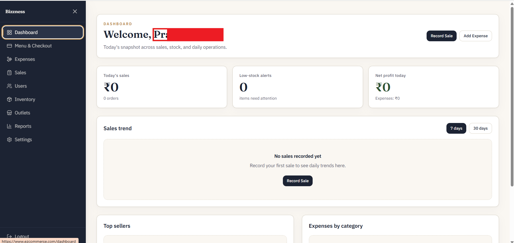

# EZCommerse

Business management platform for Restaurant owners

[](https://github.com/PrashinMore/Bizzness/actions/workflows/ci.yml)
[](LICENSE)
[](CHANGELOG.md)
[](https://github.com/PrashinMore/Bizzness/issues)
[](https://www.ezcommerse.com/)
[](#community)

## What is this?

EZCommerse (this repository is also known as **Bizzness**) helps restaurant and café owners run day-to-day operations from one place: point-of-sale, inventory, outlets, staff, expenses, CRM, and reporting. Whether you self-host or try the hosted demo, you get a practical toolkit instead of a pile of spreadsheets. Built for restaurant owners, self-hosters, developers, and hobbyists who want a modern Node.js / React stack they can extend.

<!-- TODO: replace with real screenshot -->


🚀 **Try it live:** [https://www.ezcommerse.com/](https://www.ezcommerse.com/)

## Features

- Authentication with JWT access/refresh tokens, signup, login, and password reset
- Multi-organization and multi-outlet management with invites and role-aware access
- Products, categories, and image uploads (including CSV bulk import)
- Sales / POS flows with table assignment, merge/switch, and partial cash + UPI payments
- Inventory and stock tracking, including recipe-based ingredient deduction
- Expenses, dashboard KPIs, and sales / P&L / inventory / expense reports
- CRM: customers, visits, notes, feedback, loyalty points, and rewards
- Invoicing with PDF generation
- Business settings (branding, billing, inventory, tables)
- Web app (Next.js) and companion mobile app (Expo) consuming the same NestJS API

## Quick Start

**Fastest path (API + Postgres via Docker):**

```bash
cd be
cp .env.example .env
docker compose up --build
```

The API listens on [http://localhost:4000](http://localhost:4000) (`/api` prefix). Postgres is exposed on host port `5433`.

**Web frontend (separate terminal):**

```bash
cd webFe
cp .env.example .env
npm install
npm run dev
```

Open [http://localhost:3000](http://localhost:3000).

**Backend without Docker (requires a local Postgres matching `.env`):**

```bash
cd be
cp .env.example .env
npm install
npm run start:dev
```

## Documentation

- Project docs: [docs/](docs/README.md)
- Architecture overview: [docs/architecture.md](docs/architecture.md)
- Deployment notes: [docs/deployment.md](docs/deployment.md)
- FAQ: [docs/faq.md](docs/faq.md)
- API / integration notes: [integration/](integration/README.md)

## Quality / Test Status

📋 [Live Test Case Status](https://docs.google.com/spreadsheets/d/1JUUtblZH2MWtTZ-09zjWu1WEk8J631pX8MJegCkI_cY/edit?usp=sharing) — a live-updated, view-only sheet tracking current pass/fail status of test cases, kept in sync with the project's testing efforts.

## Contributing

Contributions are welcome! Please read [CONTRIBUTING.md](CONTRIBUTING.md) for setup, branch naming, commit style, and the PR process. Issues labeled **good first issue** are a great place to start.

## Community

- Discord: _Coming soon — placeholder_
- Matrix: _Coming soon — placeholder_
- GitHub Discussions: [enable and link here](https://github.com/PrashinMore/Bizzness/discussions) — _placeholder until Discussions is turned on_

## Roadmap

See [ROADMAP.md](ROADMAP.md) for planned work. A GitHub Project board can be linked here once created.

## License

This project is licensed under the [MIT License](LICENSE).

## Acknowledgements / Contributors

Thanks to everyone who helps improve EZCommerse!

<!-- ALL-CONTRIBUTORS-LIST:START - Do not remove or modify this section -->
<!-- prettier-ignore-start -->
<!-- markdownlint-disable -->
<!-- markdownlint-enable -->
<!-- prettier-ignore-end -->
<!-- ALL-CONTRIBUTORS-LIST:END -->

This project follows the [all-contributors](https://allcontributors.org) specification. Contributions of any kind are welcome!
